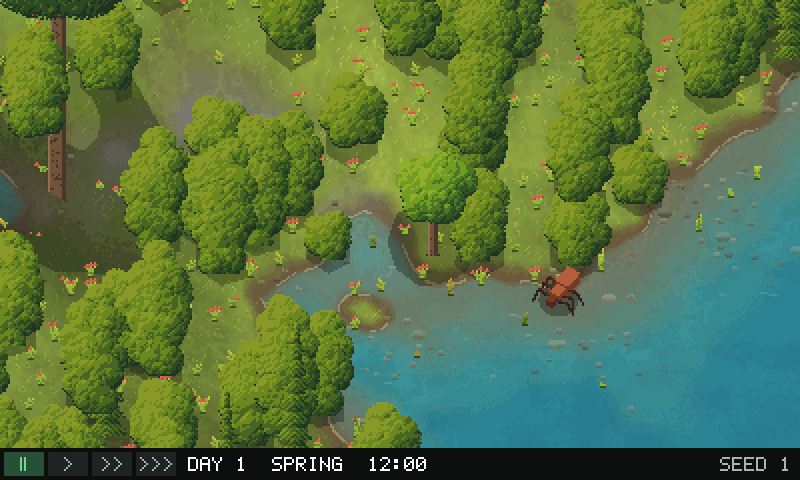

# Petri HD

An evolving world of plants and animals for a Raspberry Pi 3 B+ with a 7"
touchscreen, the successor to [Petri](https://github.com/Lizard-King101/Petri).
The design is in [docs/PLAN.md](docs/PLAN.md).

**Status:** milestone 2, plants. A generated valley running down to the
sea, with hills, streams, ponds, seasons, weather and fire, and 100,000+
plants, each with its own genome, that grow, compete, seed, evolve, burn
and come back. No animals yet. See [docs/PLANTS.md](docs/PLANTS.md).

## Build

Needs CMake, a C++17 compiler and SDL2 (only for the window).

```sh
cmake -S . -B build
cmake --build build -j
ctest --test-dir build
```

- `build/petrihd`: the window. Drag to pan, scroll or pinch to zoom,
  long-press or right-click a cell to inspect it. Space pauses, 1–4 set the
  speed, H toggles the budget HUD, S saves, F12 takes a screenshot.
  `--seed N`, `--size 1024x600`, `--load FILE`, `--ticks N` (run ahead
  first), `--shot FILE.png` (draw one frame and quit), `--frames N --speed
  0-3` (time N frames and quit).
  Above 32 px per cell the camera tilts toward a three-quarter view (zoom up
  to 256); T locks it top-down and G turns it off. See
  [docs/RENDERING.md](docs/RENDERING.md).
- `build/petrihd-run`: headless. `seed=1 ticks=3840 every=480` prints a
  census line of `key=value` pairs; `ocean=38` sets the share of sea,
  `biomes=1` lists biome shares, and `save=`, `load=` and `png=` write and
  read saves and full-resolution screenshots.
- `tools/check_arm.sh`: builds for aarch64, runs the tests under qemu and
  checks the fingerprints match x86. Needs `aarch64-linux-gnu-gcc` and
  `qemu-user`.

## Shoreline art study

Run `build/petrihd --shoreline-study` to explore the painted foliage, ground
and shallows at the reference bank. Every plant there is a pixel-art sprite,
painted once from the plant's size, kind, colour and season
(`gfx/plant_sprites.cpp`); `build/petrihd-sprites sheet.png` paints a sheet
of them without opening a window. What works and what doesn't is in
[docs/SHORELINE_REVIEW.md](docs/SHORELINE_REVIEW.md). This study opens seed 1 at tick 120,
centered on cell (186, 73), at 64 pixels per cell with a 55° camera pitch.
The ground is painted at the same density wherever the camera goes
(`gfx/ground_art.cpp`), in the colours of the bird's-eye view, and repainted
as water, plants and seasons change; `build/petrihd-ground ground.png` paints
a piece of it without opening a window. `--at X,Y` opens the study anywhere
on the map. Drag to pan, and scroll or pinch to zoom. The study starts paused. Press Space
to play and watch the foliage and test creature move.

Add `--shot shoreline.png` to capture the reference frame and exit. The
capture hides the budget HUD and uses a fixed animation phase.



## Layout

- `core/`: the simulation. Deterministic, integer, no dependencies.
- `gfx/`: the OpenGL ES 2 renderer, loaded through SDL.
- `ui/`: input and interface.
- `apps/`: `petrihd` and `petrihd-run`.
- `tests/`, `tools/`, `cmake/`, `docs/`.
