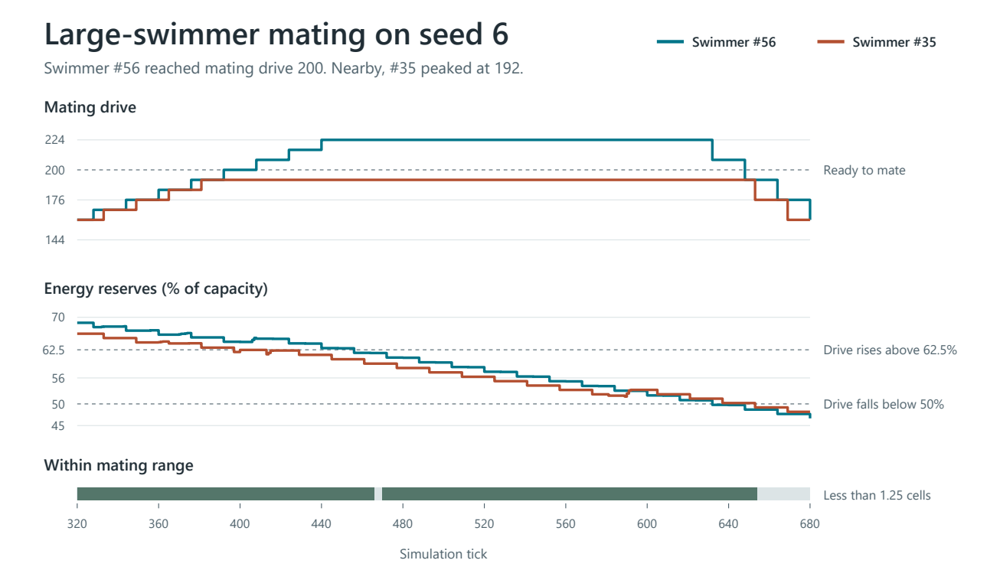

# Animals

The start of milestone 3 (bodies). Animals are in the simulation
(`core/animals.hpp`, `core/animals.cpp`): each has a genome of organs, a
body those organs add up to, a place in the world, and a metabolism. They
sense the world, decide with a brain they inherit, breed, grow up and grow
old.

Run `build/petrihd --dev-map` to watch them: the development map starts
with 48 founders. `--animals N` puts N founders into any new world. A world
without animals behaves, and fingerprints, exactly as before.

## The genome builds a body

Twenty-three genes (`AnimalGene`): size and build, pairs of legs and their
length and sprawl, fins, tail, wings, neck, gills or lungs, a plant gut and
a meat gut, fat, pigment and pattern, how fast it grows up, how many
young it has at a time, how far it sees, how keen its nose is, how far it
hears, and the pitch of its voice. `frame()` turns them into a body:

- **Mass.** The trunk is a cylinder of flesh; legs, wings, fins, neck, tail,
  guts and fat are all counted against it. Upkeep and the size of a
  mouthful follow mass to the power 3/4.
- **Speed in each medium.** Legs under the body stride further than legs out
  to its sides. Fins and a tail drive a swimmer; legs alone only paddle.
  Wings fly only if they are big enough for the mass they must lift.
- **Breath.** Lungs, gills or both. Where it cannot breathe an animal holds
  its breath for a minute of world time, then is hurt, then dies.
- **Wading.** How deep it can stand follows its legs.

There are no kinds of animal. The founders are a grazer, a six-legged
crawler, a flier, a small fish and a large swimmer, each with its
proportions varied a little.

## Senses

The brain receives 63 inputs from `World::senses`.

- **Sight**, in five sectors about its heading; behind is unseen. How far
  it sees is its eyes gene, 3 to 10 cells, and eyes have mass and upkeep.
  Each sector reports:
  - grazing its body can get at, nearer counting for more (meadow grass is
    nothing to a fish, nor waterweed in deep water to a walker);
  - how near the nearest animal is, its size against its own, and how like
    its own its genome is;
  - ground its body cannot go on, and the edge of the world;
  - when it is ready to mate: how near the nearest animal is that is ready
    too and near enough alike.
- **Ahead:** the cell its next steps reach, seen alone: its grazing, and
  whether its body can go there.
- **Itself:** energy, health, breath, how far it is from full grown, its
  drive to mate, whether it is on land, in water or in the air, the grazing
  where it is, the daylight, a number that is different every time, and
  three numbers its brain told itself last time.

- **Smell**, for one with a nose (a gene; none below 32, then keener).
  Scents lie on a grid of nodes four cells across, spreading to their
  neighbours and fading by an eighth every four ticks. The three scents are
  grazing, animals, and animals ready to mate. For each, an animal smells
  how strong it is where it stands, and how much stronger it is ahead than
  behind and to its right than to its left, which is what tells it where
  to turn. The scent of a mate carries what kind of body made it, and
  registers only when the animal is itself ready and the body is like its
  own.
- **Hearing**, for one with ears (a gene; it sets how far, 4 to 36 cells).
  Of the calls it can hear just now it knows the loudest: how loud, how
  like its own voice the pitch is, and, if it is in a voice like its own,
  where it is coming from.

At its mouth the animal senses the length of the nearest body it can
strike relative to its own. A hit produces a pain strength and two signed
directions, ahead and right. The bearing stays fixed in the world as the
animal turns. Strength falls by six per tick from a maximum of 127.
Fear is a separate drive in the design plan and is still unimplemented.
The wind does not carry scent. The scent of
animals does not yet say what kind of animal, which a prey animal will need
to tell a predator from a neighbour.

## The brain

Every animal has a brain of its own (`core/brain.cpp`) with 63 inputs, 16
hidden units, 10 outputs and 1194 int8 weights. Its integer arithmetic is
the same on every machine. The network's arithmetic, its crossover and its
mutation are Petri's. Each animal decides every four ticks, or every 0.4
seconds at normal speed. Its outputs control these actions.

- **turn** and **pace**;
- **Eat.** A meat gut can take a mouthful from a carcass in reach.
  A plant gut can graze when it finds no edible meat. Any grazer can
  graze what grows low (up to 1.5 m); reach only matters for browsing what
  grows taller. A mouthful grows with the body, as its needs do;
- **Attack.** Try a strike with the mouth. A miss also costs energy.
- **mate**: both animals must be ready, both must choose to, and they must
  be within a cell and a quarter of each other;
- **fly**, for one with wings big enough: up while it chooses to, down when
  it stops;
- **call**: heard for most of a second, at the pitch of its voice (a
  gene), louder from a bigger body, and costing a little energy;
- three numbers to remember.

Nothing else steers it. An animal can walk into deep water and drown, or
swim ashore and suffocate; only the edge of the world stops it.

### Brain channels

Indices below are zero-based. The three memory outputs feed back as signed
bytes on the next decision. Each animal keeps its weights for its lifetime.

| Input indices | Values in order |
| --- | --- |
| 0–29 | Five sectors, far left, left, ahead, right, far right. Six values per sector in order of food, nearest animal, its relative size, its genetic similarity, hazard, nearest compatible ready adult. |
| 30–34 | Own energy, health, breath, youth, mating drive (raw drive divided by two). |
| 35–37 | On land, in water, in air. |
| 38–42 | Food here, food ahead, hazard ahead, daylight, noise. |
| 43–45 | Previous memory outputs 0, 1, 2. |
| 46–54 | Plant scent (46–48), animal scent (49–51), ready-mate scent (52–54). Each gives local strength, the forward gradient and the rightward gradient. |
| 55–58 | Loudness of the loudest call, voice similarity, forward and rightward bearing. |
| 59–62 | Relative size of the animal at the mouth, pain strength, forward and rightward pain bearing. |

Outputs 0–9 are turn, pace, eat, mate, fly, call, memory 0, memory 1,
memory 2 and attack. A positive output activates eat, mate, fly, call or
attack. Turn and pace use the output magnitude.

The five ready-neighbor inputs are 5, 11, 17, 23 and 29. A fully grown
observer needs at least 200 drive. A visible adult within 240 genome
difference points then registers if its drive is at least 200, even if its
mate output is off. The nearest animal and nearest ready adult in a sector
can be different individuals. Mate scent has the same observer threshold.
It reflects recent emissions and similarity of legs, fins/gills and wings.
A ready observer can still smell a fish that has just lost readiness.

**Inheritance.** A child's brain takes each hidden unit whole from one
parent or the other, with its incoming and outgoing weights, so a unit
stays a working part. Then each weight has one chance in 128 of a small
step.

The **founders** start with reflexes wired by hand. They turn toward
visible grazing, turn away from impassable ground, wander and eat when
hungry. When ready to mate they call and turn toward a visible mate, a
mate's scent or a call like their own. Those that can fly take to the air
when they see no food.
New founders turn away from the side that was hit and increase their
pace while pain lasts. The large swimmer also starts with a weak turn
toward smaller bodies and a strike response to hunger and a smaller
animal at its mouth. These are inherited weights. Every body can express
the attack output.

They are not wired to follow the smell of grazing. That was tried: every
founder made for the same lush places and starved there together. What to
do with that smell is left for evolution to find.

Founders are put down in families, four of a kind near each other, since
one alone on the far side of the map never finds a mate.

## The controls

All four modes start with the same founders on a given seed. Bodies come
from the two animals that mate. The mode controls which brain a newborn gets.

| Mode | Brain inheritance |
| --- | --- |
| `evolving` | Recombine the parents' brains and mutate the weights. |
| `frozen` | Recombine the parents' brains with mutation switched off. |
| `shuffled` | Recombine the parents' brains and shuffle the resulting weights. |
| `neutral` | Draw two distinct brain donors at random from the animals alive at the start of the tick, then use the same crossover and mutation as in evolving mode. |

In the neutral control, juveniles can donate and siblings get separate
draws. This tests whether inheriting the successful breeders' wiring
matters. Survival still affects which brains are available to donate.

`build/petrihd-run layout=development animals=56 seed=1 brains=neutral ticks=153600 every=0`
prints the population at year 40, including a zero count if it died out.
A save records its brain mode. Version 13 also stores the current forage
field so a resumed animal senses the same food between surveys. Passing
`brains=neutral` on reload switches inheritance for subsequent births.
To watch this control in the window, run `build/petrihd --dev-map --brains neutral`.

`python tools/compare_brains.py build/petrihd-run --jobs 4` runs all four
modes across seeds 1 through 8 and writes the final censuses as CSV.

Before adding predation, at 40 years (153,600 ticks) with 56 founders per seed, the
counts below are **walkers / fliers / swimmers**. Walkers include crawlers.

| Seed | Evolving | Frozen | Shuffled | Neutral |
| --- | --- | --- | --- | --- |
| 1 | 258 / 62 / 561 | 321 / 0 / 355 | 0 / 0 / 4 | 315 / 0 / 606 |
| 2 | 373 / 0 / 299 | 408 / 0 / 56 | 0 / 0 / 0 | 309 / 0 / 146 |
| 3 | 398 / 0 / 523 | 429 / 27 / 235 | 0 / 0 / 0 | 433 / 0 / 154 |
| 4 | 420 / 0 / 678 | 293 / 140 / 258 | 0 / 0 / 0 | 383 / 0 / 515 |
| 5 | 372 / 0 / 358 | 340 / 0 / 130 | 0 / 0 / 0 | 316 / 0 / 312 |
| 6 | 293 / 5 / 584 | 215 / 79 / 112 | 0 / 0 / 0 | 330 / 0 / 0 |
| 7 | 459 / 0 / 664 | 310 / 0 / 0 | 0 / 0 / 1 | 387 / 0 / 1 |
| 8 | 330 / 97 / 226 | 199 / 482 / 163 | 0 / 0 / 0 | 382 / 0 / 355 |

All eight evolving populations survived. Each had more animals at year 40
than its shuffled counterpart. Six shuffled populations went extinct. The
other two ended with four swimmers on seed 1 and one swimmer on seed 7.

Evolving populations finished larger than neutral on six seeds and larger
than frozen on seven. Evolving brains produced more surviving swimmers than
frozen brains on all eight seeds. On seed 8, 482 fliers survived with
frozen brains, bringing that population to 844 animals. The evolving world
on that seed ended with 653.

The earlier three-seed table gave different counts. A clean build of
`fed75d7` reproduced the new seed 1 evolving census of 881 animals and
its fingerprint, `db1bfb557117b349`, at tick 153,600.

## Predation on the development map

A strike can reach forward up to one cell once every eight ticks. Reach
depends on both body lengths. The two animals must occupy the same medium
and be close enough in height. Relative length sets the damage. A lethal
strike leaves a carcass at the victim's position with the killer's ID.
Starvation and suffocation also leave carcasses. Each contains the body's
remaining reserves and tissue energy. Feeding removes a finite mouthful
and credits the energy the eater actually absorbed. The rest decays into
litter, including after the last animal dies.

The census follows the maternal founder lines of the large swimmers and
small fish. A hunter qualifies as a breeder when it first produces young
after eating from an animal it killed itself. Either parent can qualify.
Each newborn counts once. The generation count measures consecutive
qualifying parents and offspring. The census records scavenged energy
separately. Plant food is available throughout the study.

Version 14 saves retain carcasses, the bearing and strength of pain, and
the hunting history. Version 12 and 13 brains keep every learned weight
and bias. Their new connections start at zero. Earlier saves lack founder
cohort records, so their existing animals remain outside the fish census.

### Forty-year results

Each development map started with 56 founders, including eight large
swimmers and sixteen small fish. Each seed ran for 153,600 ticks in all
four brain modes. In the evolving worlds, 51 of the 64 large swimmers ate
from their own kills. None produced young. The last large swimmer died
before the end of year two on every seed.

| Seed | Large swimmers that ate their own kill | Small fish killed by large swimmers | Small fish at year 40 | Small fish at year 40 before predation |
| --- | ---: | ---: | ---: | ---: |
| 1 | 6 | 15 | 0 | 561 |
| 2 | 7 | 13 | 373 | 299 |
| 3 | 7 | 12 | 0 | 523 |
| 4 | 6 | 13 | 0 | 678 |
| 5 | 7 | 13 | 0 | 358 |
| 6 | 6 | 10 | 723 | 584 |
| 7 | 6 | 14 | 0 | 664 |
| 8 | 6 | 13 | 546 | 226 |

On the same eight seeds, the earlier grazing build also produced zero
large-swimmer young. Its year-40 fingerprints matched the original
evolving runs. During the predation runs, five large swimmers reached the
mating drive threshold of 200 at some point. Only one was observed at or
above that threshold after eating its own kill.

Across the 32 runs, large swimmers ate from their own kills on every map
and no qualifying hunter produced young. Small fish survived to year 40
on three evolving seeds, one frozen seed, one shuffled seed and two neutral
seeds. [Full year-40 census for all four brain modes](experiments/swimmer-predation-40y.csv)

### Where large-swimmer mating stopped

We replayed the eight evolving worlds from founding until the last large
swimmer died. The trace recorded each adult and all genetically compatible
adults at every tick, then checked them again immediately after each
swimmer's energy and mating drive updated. On these seeds every compatible
partner was another large swimmer. All eight replays matched the normal
runner's world fingerprint at extinction.

Every one of the 64 founders came within mating range of a compatible
adult before its own energy first fell below half on a metabolic pass.
The median first encounter was tick 27. The median first drop below half
was tick 411. Only five founders reached a mating drive of 200, and no
two compatible adults were ever ready at the same time, even at a
distance. Four of the five spent time in range of a partner while ready.
The mate action was active on 180 of the 185 passes when a swimmer was ready.

| Seed | Distinct pairs within 1.25 cells (of 28) | Adults ever ready (of 8) | Starvation deaths | Last large swimmer died at tick |
| --- | ---: | ---: | ---: | ---: |
| 1 | 28 | 2 | 5 | 6726 |
| 2 | 21 | 0 | 6 | 2084 |
| 3 | 27 | 0 | 6 | 1734 |
| 4 | 27 | 1 | 8 | 1810 |
| 5 | 26 | 0 | 8 | 1576 |
| 6 | 26 | 1 | 7 | 2008 |
| 7 | 26 | 0 | 7 | 1705 |
| 8 | 25 | 1 | 5 | 1741 |

**Seed 6 came closest.** Swimmer #56 was ready from tick 392 through
647. It spent 252 of those 256 ticks within reach of #35, whose drive
held at 192. At tick 381, #35 had 63.0% of its energy capacity and
gained eight drive points to reach 192. By its next metabolic pass it
had 62.0%, below the 62.5% needed for another increase. At tick 653 its
energy fell to 49.2% and its drive dropped to 176.



Across the eight seeds, 59 swimmers exhausted their reserves at least
once. Starvation caused 52 deaths, attacks caused seven and suffocation
caused five. The immediate obstacle to breeding was sustaining energy
long enough for two adults' readiness to overlap.
[Per-swimmer lifetimes and mating checks](experiments/swimmer-mating-lifetimes.csv)

To reproduce the trace, build the optional `petrihd-swimmer-trace` target.
It runs seeds 1–8 by default and accepts a single seed as an argument.
Redirect its output to `trace.csv`, then run
`python tools/summarize_swimmer_trace.py trace.csv` for one row per adult.
The raw CSV includes energy reserves, drives, both animals' mate choices
and squared distance in units of (1/256 cell)². The optional target
compiles the observation code into its own copy of the simulation.

### The large-swimmer nursery

#### Lesson 1 in the training pond

Each trial starts two compatible, healthy adults one cell apart at 60%
reserves and zero mating drive. The 18 by 10 cell pond has a 16 by 8 cell
swimming area, two metres of still freshwater, a temperature of 18 °C and
fixed light of 200/255. Every wet cell carries a short reed with 600 edible
energy restored before each tick. Feeding consumes actual bites. The
simulation runs the usual brain, movement, metabolic and reproduction rules.

One swimmer carries the candidate brain. The reference carries the
hand-wired founder brain with its pace output set to minimum so it stays
by the food. Its other decisions come from its own network. A pairing of
two references must produce a birth on at least three of four calibration
seeds (7301–7304) before scoring starts. Initial headings change by seed.
The candidate occupies the left and right bodies twice each per panel.

Each trial ends at its first candidate-parented birth or at tick 960.
The ranking compares these totals across the same four training setups
(7311–7314), in order.

1. Setups with a birth. Either parent role counts and a brood counts once.
2. Mean timing. At either founder's metabolic check while the pair is strictly within 1.25 cells, take the lower drive before a birth resets it. Divide the best value, capped at 200, by 200.
3. Mean feeding. Count the candidate's metabolic checks above 62.5% reserves, cap at 25 and divide by 25.

The first four distinct brains in rank order are retained. Exact ties
use the original pool order. Each retained brain earns promotion after
births on at least three of four setups in **each** fresh block (7321–7324,
7331–7334). The weights stay fixed throughout all three panels. The
trial log also records actual bite counts, parent IDs, and movement and
calling energy spent after the first ready tick through the final tick.

```sh
cmake --build build --target petrihd-nursery
build/petrihd-nursery train build/lesson1 4 --visual
```

Open `build/lesson1/nursery.html`. Choose a brain and a trial to replay.
The gold swimmer is the candidate and the green swimmer is the reference.
Both have a bite counter and energy and drive gauges. **First readiness**
and **First birth** jump to the exact recorded tick and pause. At a birth the
viewer holds the final frame and shows the drive recorded before reset.
Every replay is re-simulated and checked against its scored fingerprint.
Clean view, full screen, scrubbing and clip recording work offline.

The output includes an editable `pond.cfg`, rankings, individual trials
and four tick-zero donor saves. The first swimmer in each donor carries
the retained candidate. Pass `--preset path/to/pond.cfg` to a later batch
to set dimensions, depth, temperature in tenths of °C, light, food per
cell, starting energy, spacing and time limit.

In batch 1, the reference pair bred on all four calibration setups.
Eleven of sixteen brains tied on four births, maximum timing and maximum
feeding. The four retained brains all went 4/4 on both validation blocks.
The remaining seven tied brains were outside the four retention slots.
[Rankings](experiments/lesson1-batch1/rankings.csv) · [Trial records](experiments/lesson1-batch1/trials.csv) · [Preset and retained brains](experiments/lesson1-batch1)

**Validation of all eleven tied brains.** The seven additional brains produced
young on all 56 setups. Replaying the original four reproduced every field
and fingerprint in their 32 archived trials. All eleven scored 4/4 on
both validation blocks with maximum feeding and timing. In every pair one
swimmer reached drive 200 on tick 398 and the other on tick 399, reflecting
their staggered metabolic checks. The earlier swimmer incurred zero energy charges during
that tick. After both were ready, the pairs started 10,149 of 10,665
ticks (95.2%) outside mating reach.

The energy records cover the tick after the first swimmer became ready
through the birth tick, inclusive. The log attributes actual swimming,
calling, striking and basal upkeep charges to each swimmer. All strike
charges were zero in this batch. Food intake and energy transferred to
offspring are separate from expenditure. The per-seed records also give
each swimmer's charges while it alone was ready, and while both were
ready, using their drives at the start of each tick.

Across the eight matched seeds, slots 1, 14, 11 and 15 had the lowest
mean total expenditure for the pair. Counting swimming and calling alone
gave slots 1, 15, 11 and 8. Slot 14's pair averaged 56 ticks from first
readiness to birth, and slot 8's averaged 154.
[Per-brain means](experiments/lesson1-batch1/validation-ties-summary.csv) · [All 88 paired trials](experiments/lesson1-batch1/validation-ties-trials.csv)

```sh
python tools/compare_lesson_one_ties.py build/petrihd-nursery docs/experiments/lesson1-batch1
```

#### Lesson 2 in the same pond

Slots 1, 14, 11 and 15 entered with their Lesson 1 weights and the same
reference partner (`9ec731457bd432de`). The 76,800 edible energy available
at the start of each tick was distributed over 16 cells in three reed
beds. Both swimmers start on the middle 2 × 2 bed. A 3 × 2 bed lies on
each side across three cells of open water. Each planted cell replenishes
to 4,800 edible energy per tick. The preset accepts one
`food_patch=x,y,width,height` line per bed, in map-cell coordinates.

The batch ran the same eight seeds (7321–7324 and 7331–7334) in each
layout with matching headings, candidate sides and a 960-tick limit.
All 32 uniform controls reproduced the archived Lesson 1 trials, including
their fingerprints. The reference pair bred on all four patch calibration
seeds. All four candidates bred on 8/8 patch trials and each ate on a
side bed in every trial. The reference took all its bites on the middle bed.

| Pool slot | Within mating range, uniform → patches | First readiness to birth, mean ticks | Pair energy in that interval | Whole-trial pair energy per birth |
|---:|---:|---:|---:|---:|
| 1 | 23.9% → 34.5% | 28 → 38 | 1,281 → 1,681 | 17,670 → 17,799 |
| 14 | 18.6% → 30.2% | 56 → 59.9 | 2,549 → 2,724 | 18,927 → 19,135 |
| 11 | 34.3% → 45.2% | 78 → 54 | 3,061 → 2,199 | 18,138 → 17,193 |
| 15 | 31.4% → 40.9% | 88 → 66 | 3,238 → 2,791 | 19,402 → 18,782 |

Proximity is the fraction of ticks that began with both founders alive
and strictly less than 1.25 cells apart, pooled across the eight seeds.
The summary also reports proximity specifically while both were ready.
Energy includes swimming, calling, strikes and basal upkeep. The
first-readiness window starts the tick after either swimmer reaches drive
200. Whole-trial energy includes all attempts from tick zero, divided by
the number of trials that produced a first birth. Slot 11 used the least
whole-trial energy in the patch pond. Slot 1 reached birth fastest once
either swimmer was ready.
[Paired results](experiments/lesson2-batch1/summary.csv) · [Patch trials](experiments/lesson2-batch1/trials.csv) · [Uniform controls](experiments/lesson2-batch1/controls.csv) · [Preset, calibration and four donor saves](experiments/lesson2-batch1)

```sh
cmake --build build --target petrihd-nursery
build/petrihd-nursery lesson2 build/lesson2 docs/experiments/lesson1-batch1/pond.cfg docs/experiments/lesson2-batch1/pond.cfg 1 14 11 15 --visual
```

Open `build/lesson2/nursery.html` to replay any of the 32 patch trials.
The first swimmer in each `slot-N.phdw` is the selected brain, saved at
tick zero on seed 7321. Loading the save restores the planted cells and
their replenishment.

#### Selective breeding with roaming partners

Lessons 1 and 2 screened existing brains and supplied the four starting
parents. The next exercise breeds their descendants. Each round tests
both parents and offspring for births, family survival, food eaten and
energy spent. Four selected brains seed the following round in the same
pond. The simulator keeps weights fixed during each animal's lifetime.
[How selection works, saved breeders and measured limits](experiments/peer-breeding-batch1/README.md)

#### Earlier development-map pilot

Petri's original nursery tested inherited brains in fresh worlds. The HD
pilot gives eight large-swimmer founders a candidate brain and lets all
56 animals live, feed and breed under the development map's usual rules.
The founding bodies, positions and starting energy match across treatments
on each seed. Offspring inherit and mutate their brains normally.

The nursery starts with sixteen candidate brains, including the hand-wired
one. It supplies variation in appetite and cruising pace, and applies four
to twelve passes of the existing weight mutation. Each candidate gets up to
three years on each of seeds 7001–7003. Four candidates become parents of
the next pool through hidden-unit crossover and mutation. The four rounds
evaluate 52 candidate slots in 156 training worlds. The random-parent
control starts with the same brains and receives the same crossover and
mutation draws, with parents retained by a random draw.

Selection compares seven totals across the three training seeds, in the
following order. The first unequal total decides which candidate ranks higher.

1. Maps where a wild-born large swimmer matured and both fish populations remained at the end.
2. Maps with a grandchild or later generation of large swimmers.
3. Maps where a wild-born large swimmer matured.
4. Maps with a large-swimmer birth.
5. Maps with a large swimmer that bred after eating from its own kill.
6. Number of large-swimmer young, capped at eight per map before summing.
7. Each map contributes 200 if a birth occurred. Otherwise it contributes the highest observed drive of the less-ready member of a compatible adult pair within 1.25 cells, sampled every 16 ticks.

The highest-ranked brain was discovered in the
initial pool and retained for all four rounds. None of the training
candidates produced young.

After selection, each treatment ran for 40 years on the same eight fresh
seeds, 7101–7108. A recruit is an offspring that reached adulthood.

| Founder treatment | Seeds with births | Young born | Adult recruits | Seeds with large swimmers at year 40 | Seeds with small fish at year 40 |
| --- | ---: | ---: | ---: | ---: | ---: |
| Hand-wired | 0/8 | 0 | 0 | 0/8 | 5/8 |
| Nursery-selected | 0/8 | 0 | 0 | 0/8 | 7/8 |
| Random-parent control | 2/8 | 3 | 1 | 0/8 | 4/8 |

On seed 7101, a control swimmer that had eaten from its own kill became
a parent at tick 3122. Two young were born and one reached adulthood.
The third young was born on seed 7104. No grandchildren were recorded.
These releases establish that unassisted breeding and maturation are
possible on this layout. The selected family did not establish a
self-sustaining population. [All 24 release censuses](experiments/swimmer-nursery-40y.csv)

#### Mixed pools, drive loss and food patches

These are three-year trials of fixed brains on a fresh block of seeds,
7201–7208. A is the pilot's selected brain (`3f1ad7902b69fe75`), B is the
random-parent control (`eb80ad9d6ccc4a3b`), and the helpers use the
hand-wired large-swimmer brain. Each seed has a pure pool for each brain
and four mixed assignments. Rotating the brains puts A and B in every
founder slot once. Bodies, homes and starting reserves are matched within
a seed. Each newborn records both parent IDs.

On the full development map, the mixed pool has two A, two B and four
helpers. In the table, a tick counts once if any two compatible grown
swimmers qualify. Observations are taken at the end of every tick before
the first birth. The drive cutoff is strictly greater than 100. Mating
reach is strictly less than 1.25 cells.

| Drive loss below half energy | Mean ticks both above 62.5% energy | Mean ticks both above 100 drive | Of those ticks, within mating reach | Trials with a birth |
| ---: | ---: | ---: | ---: | ---: |
| 16 | 314 | 477 | 48 | 0/32 |
| 8 | 314 | 535 | 51 | 0/32 |
| 4 | 314 | 638 | 52 | 0/32 |

Across all 168 full-map trials, including the pure pools, no compatible
pair was observed with both drives at 200 or above and no large swimmer
was born. The experiment sets the loss for every animal in a world.
The ordinary world uses a loss of 16. Energy between 50% and
62.5% holds drive steady. The 25 well-fed checks needed to rise from 0 to
200 can be separated by time in that band. [Full-map trials](experiments/swimmer-pool-drive-3y.csv)

The food comparison kept only the first four large swimmers from each
lake. The stocked treatment filled empty plant slots in the lake water
within one cell horizontally and vertically of each founder with short
reeds holding 600 energy apiece. This was a one-time planting. Water
levels, grazing, birth costs and hungry drive loss followed the normal
rules. Each mixed pond contained one A, one B and two helpers.

| Four-swimmer pool | Unstocked trials with a birth | Stocked trials with a birth | Young in stocked ponds | Young reaching adulthood |
| --- | ---: | ---: | ---: | ---: |
| All A (selected) | 0/8 | 0/8 | 0 | 0 |
| All B (random-parent) | 0/8 | 8/8 | 30 | 4 |
| All hand-wired | 0/8 | 8/8 | 18 | 1 |
| Mixed, four rotations per seed | 0/32 | 32/32 | 55 | 3 |

A directly parented 3 of the 55 mixed-pool young and B directly
parented 37. Each family gets credit once per newborn if either parent
belongs to it. None of A's mixed-pool descendants matured. No pond
produced a grandchild. The four rotations are repeated assignments on
the same eight seeds. [Paired pond trials](experiments/swimmer-pond-food-3y.csv)

A separate feeding probe ran four hand-wired founders in each stocked
pond for up to one year. At each founder's four-tick decision interval,
it replayed the same end-of-tick sensory inputs, including memory, through
A, B and the hand-wired brain. Across 3,485 samples with food in the
current cell and reserves above 62.5% through 75%, A chose eat once, B
chose it 3,485 times and the hand-wired brain 878 times. Below half energy
all three chose eat on all 332 samples. These counts describe decisions
on the hand-wired fish's trajectories. [Feeding decisions by seed and energy band](experiments/swimmer-pond-feeding.csv)

To reproduce, use the donor saves that the four-round trainer writes.

```sh
python tools/compare_nursery_pools.py build/petrihd-nursery build/nursery/round-4.phdw build/nursery/random-parent.phdw --jobs 4
python tools/compare_nursery_pools.py build/petrihd-nursery build/nursery/round-4.phdw build/nursery/random-parent.phdw --jobs 4 --pond
build/petrihd-nursery feeding-probe build/nursery/round-4.phdw build/nursery/random-parent.phdw 7201
```

The four-adult food comparison motivated the two-adult Lesson 1 pond.
The original four-round selection rule and release trials remain
available through the `pilot` command.

#### Reproduce the development-map pilot film

```sh
cmake --build build --target petrihd-nursery
build/petrihd-nursery pilot build/nursery 8 --visual
```

Open `build/nursery/nursery.html` as soon as it appears. It picks up new
chapters as rounds finish. Each round shows the strongest new challenger
and, when it differs, the retained family on the same seed. The final two
chapters show the selected and random-parent families released on seed
7101. Once training finishes, the HTML contains the entire replay and
can be copied by itself.

Land elevation and vegetation depict the habitat at founding. The replay
samples water depths every half day and at the first birth, so the camera
can follow a swimmer onto the floodplain. Fish positions, headings, energy,
drive, kills and births come from the simulation. Poses are sampled every
six ticks and interpolated for playback. Training chapters cover up to
2400 ticks and release chapters up to one year. A chapter ends early when
its last large swimmer dies. The 40-year census covers the full run.

Click a fish to inspect it, choose **Follow fish** for a close-up, or use
**First birth** to jump just before a recorded birth. **Clean view** (C)
hides the overlay. **Record clip** starts a 1280 × 720 recording from
the canvas and **Save clip** downloads it. Chrome and Edge use H.264 MP4
when their encoder supports it, with WebM available as a fallback. Space
pauses, F toggles full screen, and R finishes a recording.

For headless training, omit `--visual`. Each round writes a normal
tick-zero world save. To release the selected brain on a different seed,
use `build/petrihd-nursery trial build/nursery/round-4.phdw 7101 40 start.phdw`.
Open `start.phdw` with the regular windowed app to watch the release there.

## Breeding and life history

- **The drive to mate** rises while a grown animal is well fed, and hunger
  holds it down, so nothing breeds its way out of starving.
- **Mates.** Two can breed only if their genomes are near enough alike
  (`genetic_distance` no more than `breeding_distance`). Finding each other
  and choosing to is the brain's business. Bodies that have
  drifted apart cannot breed: nothing names a species.
- **Young.** The one that found the other bears them: one to four, by its
  investment gene. Each takes every gene from one parent or the other, with
  one gene in eight changed a little. What a newborn starts with comes out
  of its mother, who keeps enough to live on.
- **Growing up.** A newborn is the adult's body at three eighths of its
  length, and so a twentieth of its mass. It grows while it is fed, as fast
  as its maturity gene allows, and can breed when full grown.
- **Growing old.** Upkeep rises with age, so an old animal needs more and
  more to stay alive. It is gentle: where nothing competes with them, some
  founders are still alive after fifteen years, which is too long.

There are no sexes, no eggs, no choice of mate and no care of young yet.

## What it shows so far

In the grazing runs before predation, over the first fifteen years with evolving brains,
grazers hold between 60 and 170, fliers between 30 and 200 and fish between
30 and 320. After that the grazers and fish keep climbing (see the
controls above). In the earlier grazing runs, mean energy in low plants
fell from about 60 to under 10 as the herds grew.
Crawlers never establish: they are slow, and lose to the
grazers for the same grass.

Founders that breathe water start in a lake: nothing grows in the sea for
them yet.

## On the map

Below 32 px per cell, where the view is the bird's-eye map, every animal is
a dot in its own colour on the art's pixel grid, bigger for a bigger body
and as the view closes in, with a dark rim. One in the air is paler and has
no rim. Dots can be tapped like the animals themselves.

## The inspector

Tap an animal to inspect it: it is marked on the screen, and a panel shows
what its organs make it, its organs drawn from the side to scale with each
other, bars for energy, health and breath, what it is doing, its
length, mass, legs, wings, fins, lungs or gills, diet and speeds, and its
brain at work: a row of lamps for what it senses, a row for its hidden
units and a row for what comes out, green for more and red for less. The view
follows it from then on; drag the view, or tap it again, to let it go. Tap the panel, or anywhere
else, to close it. `--inspect ID` opens it on an animal from the start.

The plan's inspector also has a live portrait, a species name, a
family tree and a life log. None of those exist yet.

## Not yet

- Touch along the sides, a persistent fear drive, windborne scents and
  scents that distinguish the kind of animal that made them.
- Nursery trials for other founder body plans.
- Eggs and sexes.
- Depth as a place: a swimmer keeps a fixed distance under the surface.
- Collisions. (Who is near is answered by a list of the animals in each
  cell, rebuilt every tick.)
- Timing on the Pi. The simulation rebuilds each animal's body every tick,
  scans the cells in sight every four ticks and evaluates the network with
  portable integer loops.
