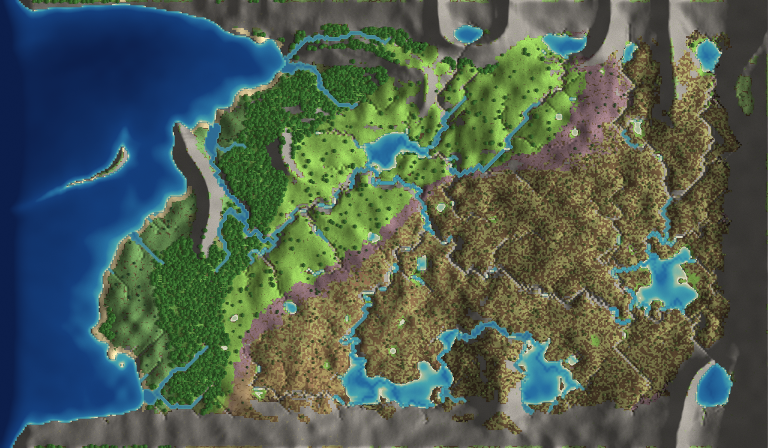
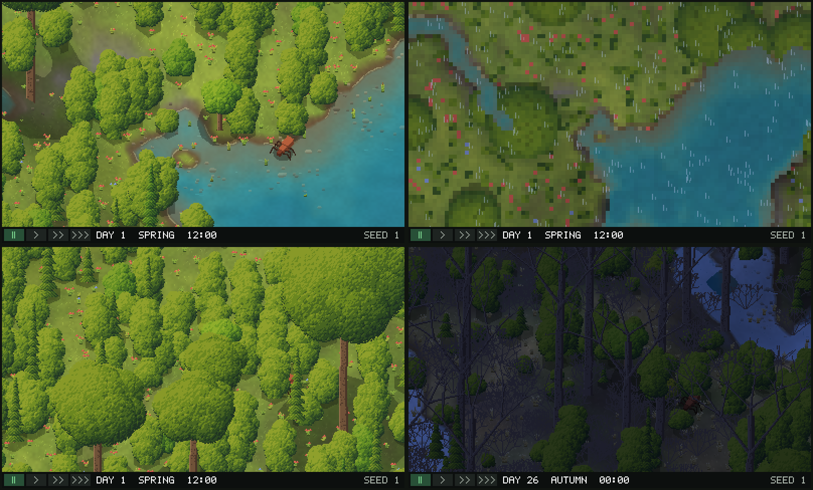
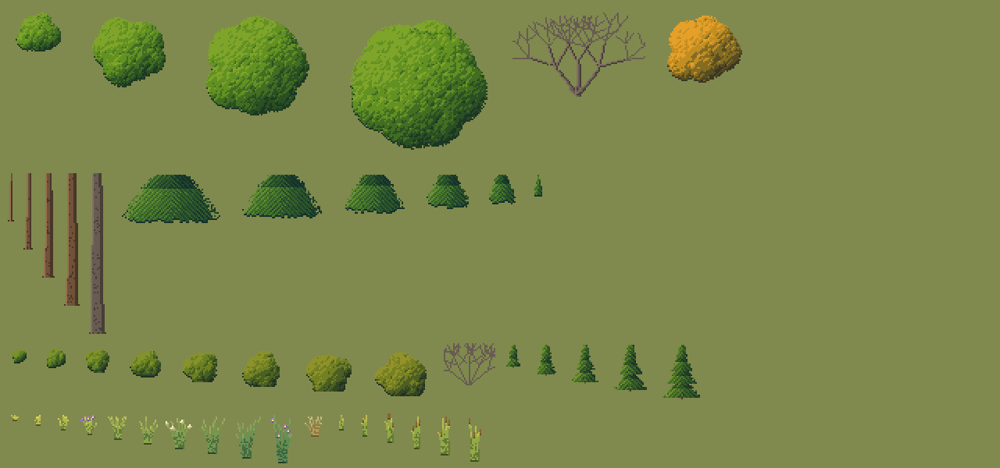
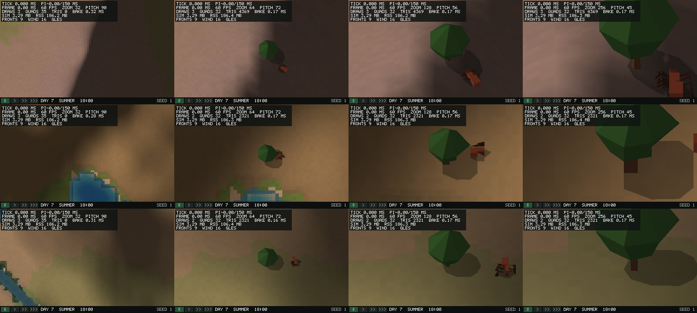

# Rendering and the camera

**Status:** November 19, 2026. The tilted camera is a prototype on the
`tilt-camera` branch.

## Scale

A cell is 1.5 m across (`phd::cell_decimetres`): a creature is 0.2–3 cells
long, and the world is a valley about 580 × 340 m running down to the sea.
Heights are in decimetres, mostly 0–50 m, and are drawn at true scale
(`--relief`, by default one cell of height per 1.5 m). Hill shading uses the
true slopes too.

## Two paths, one texture

The first frame can show the whole world from its biome colours. The CPU
then paints the 16-cell chunks on screen at 4 texels per cell, starting
near the camera focus (`gfx/terrain_art.cpp`). Each chunk is also averaged
down to 2 and 1 texel per cell. The zoomed-out view draws the level closest
to one texel per pixel to keep small shapes such as tree crowns stable.

Each chunk records the world tick and lighting mode it was painted for.
The overview spends up to about 3 ms per frame on pending chunks, finishing
the current chunk before it yields. Chunks that already have detail refresh
oldest first as the simulation plays. A paused view finishes any outstanding
work, then reuses its terrain and weather textures.

- **Ground and plants are separate layers.** The ground's colour comes from
  what it's made of (loam, sand, clay, peat, rock or gravel) and how wet it
  is. Low plants cover it in patches, as much as the biome allows. Trees are
  round crowns rooted at fixed spots in each cell, lit like domes and casting
  shadows, drawn over whatever ground they stand on. Until milestone 2 has
  plants of their own, the biome decides what grows.

| Zoom (px per cell) | Path | Pitch |
| --- | --- | --- |
| 1–32 | Flat (`gfx/world_view.cpp`): one textured quad, with clouds, fog, rain, snow and lightning over it | 90° |
| above 32 | Tilted (`gfx/tilt_view.cpp`): the same texture over a heightfield, depth-tested, with 3D objects | 72° at 64, 56° at 128, 45° at 256 |

The camera (`gfx/camera.hpp`) is orthographic throughout. Pitch follows
log2(zoom) between those keys, and zooming keeps the ground under the cursor
in place. Tilting turns about the ground at the focus, not about sea level.

- **Heightfield:** one vertex per cell corner, at the average surface of the
  four cells around it, using the water's surface wherever there is water.
  That is the same rule the bake uses for shorelines, so lakes and the sea
  are flat at their own level, rivers sit in their beds, and nothing floats
  or z-fights. One vertex buffer per chunk (at most 1,089 vertices, inside
  ES 2's 16-bit index limit), refreshed in turn as water levels move.
- **Lighting:** the flat bake hill-shades from the sun. Tilted, the bake skips
  that and the shader lights the mesh from its own normals, with the same
  formula and slope scale (`art::shade_metres`), so the change at 32 px per
  cell keeps the same shading. Chunks visible after a switch get the new
  lighting within the usual painting budget.
- **Trees change level of detail at 32 px per cell.** Flat, they are baked
  crowns. Tilted, the bake leaves the crowns out and paints forest floor
  (leaf litter, needles) where they were, and the tilted view stands real
  trees in exactly those places, with the same sizes and colours
  (`art::tree_in`), casting their own shadows: about 150 triangles each,
  115 trees and 17,500 triangles in a forest view at 64 px per cell.
- **Objects:** the test tree and the six-legged test creature are built each
  frame from flat-shaded boxes and frustums. They stand on `TiltView::ground`,
  which follows the mesh's own triangles, so feet stay on the drawn surface.

## One palette, one ground

Every view takes its colours from `gfx/palette.hpp`: substrates, the water
ramp, leaf pigments with their seasons, the five foliage tones, petals,
snow and ash. The ground itself is one painting, `gfx/ground_art.cpp`, at 32
texels per cell. The close view shows it whole; the bird's-eye bake takes one
texel of it for each of its own (4 per cell) and adds tree crowns, bushes,
flowers and hill shading. Zooming in changes the detail, not the colours.

- **What is painted:** soil by substrate, low growth in the pigment of the
  plants standing there, forest floor under canopy, the wet margin and the
  pale waterline, the bed through shallows, deepening water, ice, snow,
  burnt ground, then pebbles, blades of grass and glints.
- **Ground cache.** With `--shoreline-study` the close view keeps a wrapping
  2048 × 2048 texture covering 64 cells square. A 16 × 16 validity map tells
  the shader which 4 × 4-cell patches belong to the current window. Other
  patches show the overview texture until their detailed paint arrives.
- **Painting budget.** The renderer fills one missing patch per frame, nearest
  the focus first, including after a jump across the map. Once the view is
  filled, it checks patches after a world tick and can repaint one changed
  patch every other frame. The two texture resolutions update together.
- **Below 45 px per cell** a half-size copy (16 texels per cell) is drawn,
  so there is still one texel to a pixel.

## Plant sprites (shoreline study)

With `--shoreline-study`, plants are not built from triangles. Each is a
sprite painted on the CPU (`gfx/plant_sprites.cpp`, no GL) as it looks from
the three-quarter camera, at 32 texels per cell: one texel per art pixel at
64 px per cell. A bigger plant gets more pixels, never bigger ones.

- **Kinds:** bush, cone-shaped bush, grass and reed, and the pieces of
  trees: crown, trunk and conifer bough. Each has a leafless or withered form. Size, leaf colour, flowers and a
  shape variant come from the plant, quantised so similar plants share a
  sprite.
- **Atlas:** sprites are painted as plants need them into one 2048 × 2048
  texture, on shelves by height. When it is full, a plant takes the nearest
  sprite already painted, and the atlas is emptied and repainted every 600
  frames.
- **Drawing:** one upright quad per sprite, hung from a spot in the world.
  The vertex shader snaps that spot to a whole pixel and offsets the corners
  in texels, so sprites sit on the pixel grid. A sprite takes the depth of
  its spot; the fragment shader discards clear texels.
- **Trees follow the tilt.** A tree is a trunk plus a crown hung at the
  crown's height, or a stack of boughs up the trunk. The camera's pitch moves
  the pieces: looking down, the crown sits over the tree's spot and the
  trunk is hidden; at 45° the trunk is long. The trunk is painted at its
  longest and cut to length in the shader, so its texels are never squashed.
  Because a crown's depth comes from where it hangs, the taller tree is on
  top when seen from above. Bushes hang from their middles for the same
  reason. Grass and reeds keep one height at every pitch.
- **Foliage cache.** Quads and shadows share a 32-cell chunk. A build can
  resume across frames, checking a 1.5 ms budget after at most four cells.
  New chunks near the focus take priority. A refresh keeps drawing the
  previous complete buffers until the new sprites and shadows are ready.
  Moving away cancels an unfinished off-screen build.
- **Wind:** the shader shifts each quad's top corners by whole texels, each
  plant on its own beat.

## One pixel grid

The world is drawn into an off-screen image at half the window's logical
size (400 × 224 for the 800 × 480 panel) and scaled up by whole pixels with
no smoothing (`gfx/pixel_target.cpp`, `--pixel N`). Ground, plants and
creatures then share one pixel size, which is the pixel-art look of the
concept art. The interface stays at full resolution on top.

- **Snapping:** the camera used for drawing (`Camera::for_target`) moves the
  focus by less than a pixel, so the ground lands on whole pixels. Panning
  then slides the picture instead of resampling it, and texels don't crawl.
- **Depth:** the target has its own depth buffer: 24-bit where the GPU has
  `GL_OES_depth24` (and on desktop GL), otherwise 16-bit. The depth range
  is fitted each frame to what can be on screen, instead of a fixed ±600
  cells, so even a 16-bit buffer resolves thin legs and shadows.
- **Precision:** shaders ask for full precision wherever the GPU has it.
  At half precision, texture coordinates across the 1,536-texel terrain
  texture land up to a texel and a half off, and the error shifts as the
  camera moves.

## Controls

| Key or flag | Effect |
| --- | --- |
| Scroll, pinch | Zoom, 1–256 px per cell (32 with the tilted view off) |
| T | Lock the camera top-down |
| G, `--flat` | Turn the tilted view off |
| O | Move the test tree and creature to the focus |
| `--zoom Z --at X,Y` | Start at a zoom and focus cell |
| `--relief K` | Display cells of height per metre |
| `--pixel N` | Screen pixels per art pixel (default 2; 1 turns the grid off) |

## Results on the PC

`--frames` measures from the start of the frame through draw submission,
before buffer swap. `frame_ms_first` includes cold-cache work inside that
frame. `detail_ready_frame` is the first frame with all visible ground
and foliage detail present, and `detail_ready_ms` is elapsed time to that
frame at the uncapped benchmark speed. Both read zero if the run ends
earlier. `bake_chunks_last` counts overview chunks rebaked on the final
frame. Screenshots finish visible work for the requested tick before readback.

Seed 1, tick 1,620 (day 7, summer, evening). Each row of the contact sheet is
one place at 32, 64, 128 and 256 px per cell: a mountainside, a lake shore,
and a plain.

Mean and 99th-percentile frame times over 600 frames at normal speed, CPU
only:

| Zoom | Path | Mean frame | p99 | Terrain bake |
| --- | --- | --- | --- | --- |
| 32 | Flat | 3.30 ms | 4.66 ms | 3.30 ms |
| 64 | Tilted | 1.83 ms | 2.86 ms | 1.75 ms |
| 128 | Tilted | 1.81 ms | 2.85 ms | 1.73 ms |
| 256 | Tilted | 1.84 ms | 2.96 ms | 1.70 ms |

The tilted view is cheaper here because fewer chunks are on screen to bake.
It draws 2,300–4,400 triangles in 2–3 draw calls. The GPU's own time isn't
measured yet, and none of this has run on the Pi; the Pi's fill rate and the
cost of baking are the numbers to check there.

## Known gaps

- At 128 and 256 the ground is the 4-texel bake enlarged, so it shows as
  blocks: there is no close detail yet.
- The tilted view draws no weather: no clouds, fog, rain or lightning.
- Water is opaque and flat, with no shallows seen through, no waves and no
  flow.
- Relief is gentle at the default scale. `--relief 0.02` gives taller
  mountains.
- The test objects only appear in the tilted view; the flat view has no
  sprites for them.
- On a Wayland desktop at 2× scale, SDL 2 through `sdl2-compat` gives a
  400 × 240 drawable for the 800 × 480 window, and the compositor stretches
  it. Since the world is drawn at 400 × 224 anyway, only the interface text
  loses sharpness. X11 gets the full size.

## Phase 2

The order now: the terrain reworked to the 1–2 m scale; ground detail by
zoom on the pixel grid; then plants and creature bodies drawn from the
genome as low-poly models through the pixel grid, with procedural legs.

1. Close-up ground detail above 64 px per cell, from seeds local to each
   chunk: grain, pebbles, grass clumps and leaf litter that follow the biome
   and moisture and never rearrange as the camera moves. Either a second
   texture baked at 16 texels per cell for the chunks on screen, or a small
   detail texture per biome blended in the shader.
2. Water as its own translucent surface over a visible bed, with depth tint,
   shoreline foam and flow along `downstream`.
3. Weather in the tilted view: cloud shadows projected on the mesh, rain and
   snow in world space.
4. Sprites for plants and animals in the flat view, sharing their shapes with
   the 3D versions.
5. Measuring on the Pi, then choosing the relief, the zoom keys and the
   level-of-detail steps.
