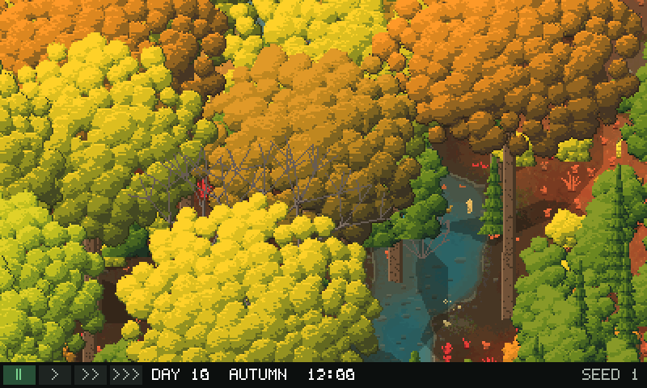
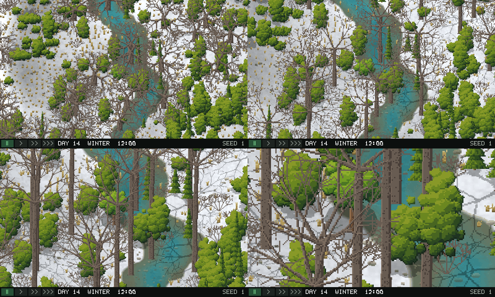
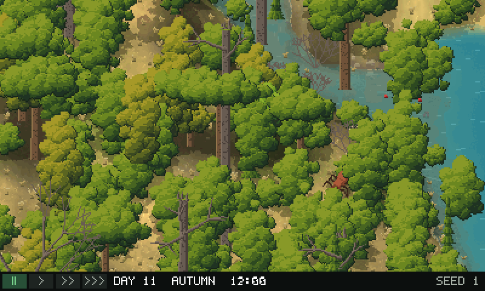
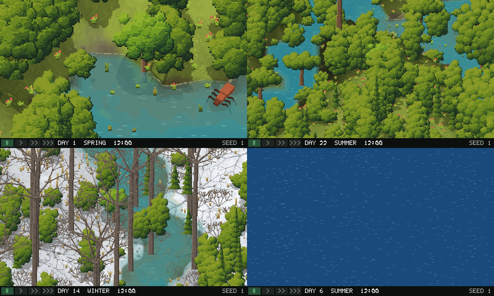
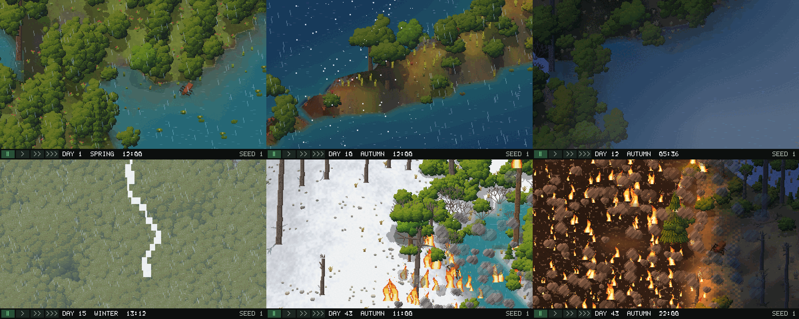
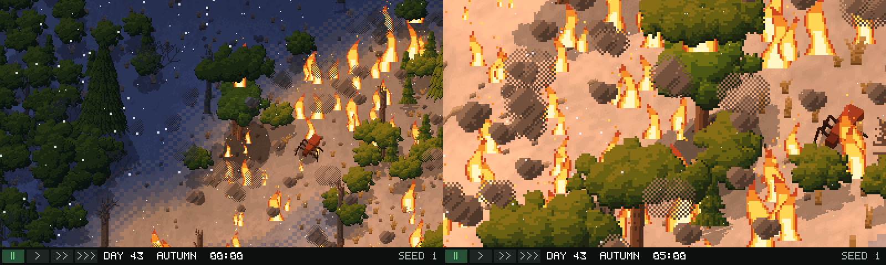
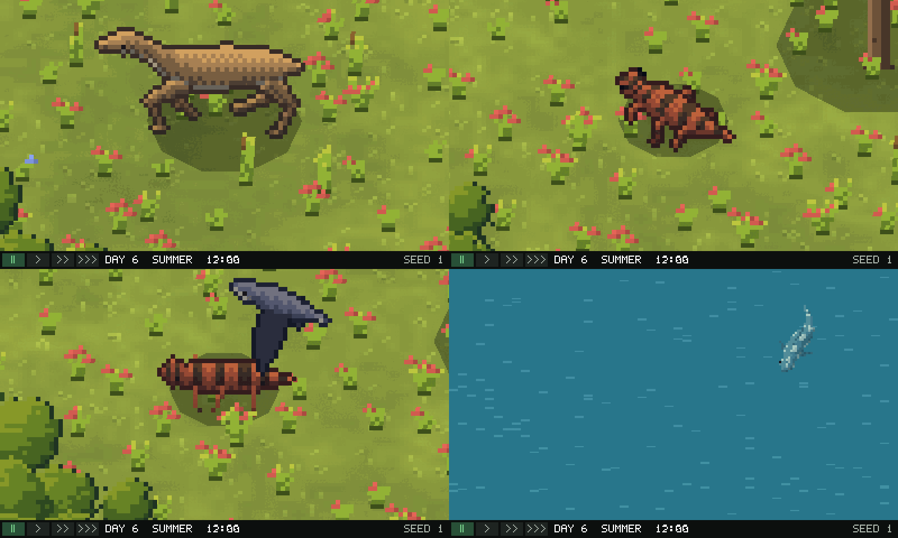

# Rendering and the camera

**Status:** November 19, 2026. The tilted camera is a prototype on the
`tilt-camera` branch.

## Scale

A cell is 1.5 m across (`phd::cell_decimetres`): a creature is 0.2–3 cells
long, and the world is a valley about 580 × 340 m running down to the sea.
Heights are in decimetres, mostly 0–50 m, and are drawn at true scale
(`--relief`, by default one cell of height per 1.5 m). Hill shading uses the
true slopes too.

## Two paths, one texture

The first frame can show the whole world from its biome colours. The CPU
then paints the 16-cell chunks on screen at 4 texels per cell, starting
near the camera focus (`gfx/terrain_art.cpp`). Each chunk is also averaged
down to 2 and 1 texel per cell. The zoomed-out view draws the level closest
to one texel per pixel to keep small shapes such as tree crowns stable.

Each chunk records the world tick and lighting mode it was painted for.
The overview spends up to about 3 ms per frame on pending chunks, finishing
the current chunk before it yields. Chunks that already have detail refresh
oldest first as the simulation plays. A paused view finishes any outstanding
work, then reuses its terrain and weather textures.

- **Ground and plants are separate layers.** The ground's colour comes from
  what it's made of (loam, sand, clay, peat, rock or gravel) and how wet it
  is. Low plants cover it in patches, as much as the biome allows. Trees are
  round crowns rooted at fixed spots in each cell, lit like domes and casting
  shadows, drawn over whatever ground they stand on. Until milestone 2 has
  plants of their own, the biome decides what grows.

| Zoom (px per cell) | Path | Pitch |
| --- | --- | --- |
| 1–32 | Flat (`gfx/world_view.cpp`): one textured quad, with clouds, fog, rain, snow and lightning over it | 90° |
| above 32 | Tilted (`gfx/tilt_view.cpp`): the same texture over a heightfield, depth-tested, with 3D objects | 72° at 64, 56° at 128, 45° at 256 |

The camera (`gfx/camera.hpp`) is orthographic throughout. Pitch follows
log2(zoom) between those keys, and zooming keeps the ground under the cursor
in place. Tilting turns about the ground at the focus, not about sea level.

- The heightfield has one vertex per cell corner and one vertex buffer per
  chunk. The standard view averages the displayed
  heights of the four adjacent cells. The shoreline study and dev map draw
  the bed and the water as separate meshes.
- **Lighting:** the flat bake hill-shades from the sun. Tilted, the bake skips
  that and the shader lights the mesh from its own normals, with the same
  formula and slope scale (`art::shade_metres`), so the change at 32 px per
  cell keeps the same shading. Chunks visible after a switch get the new
  lighting within the usual painting budget.
- **Trees change level of detail at 32 px per cell.** Flat, they are baked
  crowns. Tilted, the bake leaves the crowns out and paints forest floor
  (leaf litter, needles) where they were, and the tilted view stands real
  trees in exactly those places, with the same sizes and colours
  (`art::tree_in`), casting their own shadows: about 150 triangles each,
  115 trees and 17,500 triangles in a forest view at 64 px per cell.
- **Objects:** the test tree and the six-legged test creature are built each
  frame from flat-shaded boxes and frustums. They stand on `TiltView::ground`,
  which follows the mesh's own triangles, so feet stay on the drawn surface.

## One palette, one ground

Every view takes its colours from `gfx/palette.hpp`: substrates, the water
ramp, leaf pigments with their seasons, the five foliage tones, petals,
snow and ash. The ground itself is one painting, `gfx/ground_art.cpp`, at 32
texels per cell. The close view shows it whole; the bird's-eye bake takes one
texel of it for each of its own (4 per cell) and adds tree crowns, bushes,
flowers and hill shading. Zooming in changes the detail, not the colours.

- **What is painted:** soil by substrate, low growth in the pigment of the
  plants standing there, forest floor under canopy, the wet margin and the
  pale waterline, the bed through shallows, deepening water, ice, snow,
  burnt ground, then pebbles, blades of grass and glints.
- **Ground cache.** With `--shoreline-study` the close view keeps a wrapping
  2048 × 2048 texture covering 64 cells square. A 16 × 16 validity map tells
  the shader which 4 × 4-cell patches belong to the current window. Other
  patches show the overview texture until their detailed paint arrives.
- **Painting budget.** The renderer fills one missing patch per frame, nearest
  the focus first, including after a jump across the map. Once the view is
  filled, it checks patches after a world tick and can repaint one changed
  patch every other frame. The two texture resolutions update together.
- **Below 45 px per cell** a half-size copy (16 texels per cell) is drawn,
  so there is still one texel to a pixel.

## Plant sprites (shoreline study)

With `--shoreline-study`, plants are not built from triangles. Each is a
sprite painted on the CPU (`gfx/plant_sprites.cpp`, no GL) as it looks from
the three-quarter camera, at 32 texels per cell: one texel per art pixel at
64 px per cell. A bigger plant gets more pixels, never bigger ones.

- **Crowns are built from clumps of leaves.** A clump is about the same
  size whatever the plant, so a bigger crown has more of them. Each is lit
  on its upper left, dark beneath, and shades the clump below it; the crown
  as a whole is lit the same way and has a dark outline underneath.
- **Four crown forms, from the genome** (`art::tree_in`): loose and airy for
  trees with small wind-borne seeds, with white bark if their bark is thin;
  broad and flat-bottomed for drought-tolerant trees; narrow and tall for
  trees that need full light; round otherwise. Bushes are always round.
- **Conifer boughs** are sprays fanning from the trunk to a hem of points.
- **The ground under trees** is darker and barer than open turf, so crowns
  stand out from the meadow.

- **Bare crowns are painted for the camera's pitch.** A ball of leaves looks
  much the same from anywhere, but bare limbs do not. A leafless crown grows
  its limbs in three dimensions, then paints them as seen at 55°, 70° and
  90°. All three quads are in the mesh, and the sprite shader shows the one
  nearest the camera's pitch, so the limbs fan upward from the side and
  spread like spokes from above.

- **Snags** are a grey trunk as thick as the tree's was, snapped off at the
  top in splinters, with two or three stubs of limbs at different heights
  below the break, in the same three views as a bare crown. That is what
  tells one from a tree that is only bare for the winter. Whatever grows in the cell is drawn under it. In the bird's-eye
  map a snag is a small set of grey spokes.

- **Shadows are the plants' own outlines.** A tree's crown, a conifer's
  lowest tier or a bush is laid flat on the ground from the atlas, in
  pieces that follow the slope, and only its outline is used. A bare tree
  casts its view from above, so its shadow is its limbs.
- **Overlapping shadows darken the ground once.** The art target is RGBA
  where the GPU allows. Before the shadows, the target's alpha is set to how
  much light a shadow leaves (0.70); a shadow multiplies the ground by that
  alpha and sets it to 1, so a second shadow on the same pixel changes
  nothing. The alpha is set back to opaque when the frame ends. On an RGB
  target shadows fall back to plain blending and do stack.

- **Kinds:** bush, cone-shaped bush, grass and reed, and the pieces of
  trees: crown, trunk and conifer bough. Each has a leafless or withered form. Size, leaf colour, flowers and a
  shape variant come from the plant, quantised so similar plants share a
  sprite.
- **Atlas:** sprites are painted as plants need them into one 2048 × 2048
  texture, on shelves by height. When it is full, a plant takes the nearest
  sprite already painted, and the atlas is emptied and repainted every 600
  frames.
- **Drawing:** one upright quad per sprite, hung from a spot in the world.
  The vertex shader snaps that spot to a whole pixel and offsets the corners
  in texels, so sprites sit on the pixel grid. Grass, reeds and waterweed
  gain depth from root to tip. Crowns and other rigid pieces use their
  anchor depth. Clear texels leave the scene behind them visible.
- **Trees follow the tilt.** A tree is a trunk plus a crown hung at the
  crown's height, or a stack of boughs up the trunk. The camera's pitch moves
  the pieces: looking down, the crown sits over the tree's spot and the
  trunk is hidden; at 45° the trunk is long. The trunk is painted at its
  longest and cut to length in the shader, so its texels are never squashed.
  Because a crown's depth comes from where it hangs, the taller tree is on
  top when seen from above. Bushes hang from their middles for the same
  reason. Grass and reeds keep one height at every pitch.
- **Foliage cache.** Quads and shadows share a 32-cell chunk. A build can
  resume across frames, checking a 1.5 ms budget after at most four cells.
  New chunks near the focus take priority. A refresh keeps drawing the
  previous complete buffers until the new sprites and shadows are ready.
  Moving away cancels an unfinished off-screen build.
- **Wind:** the shader shifts each quad's top corners by whole texels, each
  plant on its own beat.
- **Handover at 32 px per cell.** At 32 and below the camera is top-down and
  the bird's-eye map is drawn; plant sprites and the painted ground show
  only above 32, as the camera starts to tilt.
- **In the bird's-eye map a bare tree is its limbs:** five grey spokes with
  the ground between, and no snow lying on them.

## Water (shoreline study)

With `--shoreline-study` or `--dev-map`, the tilted view draws water over
the lakebed. The overhead map uses the same shoreline at four texels per cell.

- **Lake and sea levels.** A lake sits at its basin's simulated water
  level all the way to the bank. The ocean sits at sea level. Rivers follow
  their channel elevations and meet the standing water at their mouths.
- **One surface.** A stream's depth follows its flow, but only as far as
  the land holds it: in a channel it fills up, and on open ground it
  spreads into a sheet a few decimetres deep rather than standing above
  its banks. It eases down to the water it runs into over the last few
  cells. A full pool in a channel passes the flow on and stands level with
  the stream below it, so a reach, its pools and its mouth are one surface.
- **Floodwater.** Overlapping river channels each contribute their flow.
  Water enters enclosed low ground through submerged banks, up to the
  lowest water level around the pocket. A pond can rise above its usual
  outlet when a swollen river backs up against it or runs through it.
- **The bed holds still.** The ground under water is the same ground when
  the water has gone: its shape comes from the terrain alone, so a flood
  rises and falls over land that does not move. Both the overhead painter
  and the tilted renderer take it from `art::water::Field` and draw water
  where the surface is above it.
- **Channels.** A stream one cell wide would be dammed at every corner
  between its banks, so the bed is cut along every cell a stream can run
  in (`Terrain::channel`: at least 16 cells drain through it), whether or
  not one is running.
- **Cell centres.** Every cell has a vertex at its own height in its
  middle, joined to its four corners, so a hollow or a hummock one cell
  wide is in the ground and the water finds it. Wading feet and cast
  shadows follow the same bed as the visible water.
- **Banks.** Where the simulation leaves ground dry that lies below the
  water beside it, the surface comes down to meet the land at the far side
  of that cell. Nothing in the water moves the ground.
- **The shore.** The water's edge is ragged: the thinnest water is drawn
  only in the low places of a noise several cells across, so the shore
  wanders on nearly level ground and the mesh does not show in it. Above
  it the bank is mud, reaching up unevenly on the side the water is.
  Sodden soil lies bare as mud in patches further off, more of them toward
  water; they stay after a flood has gone, until the soil dries.
  The overhead map's painted water has the same ragged edge.
- **Bends.** Where a channel turns, or runs corner to corner, the bank
  cell in the crook of the turn has the bed cut at three of its corners.
  Its middle is worn down to them, so a stream rounds its bends instead of
  stepping along the cells. A plant on such a cell stands in the shallows.
- **Surface details.** Noise and animation vary the colour within the wet
  area. The shallows show the bed and its shadows, with a broken pale line
  at the edge. Deep water is opaque and frozen water shows ice.
- **Water blends over the bed and its shadows.** It reads the scene depth
  so plants and animals above the surface stay visible. Wading animals and
  swimmers near the surface are drawn afterward.
- **Plants in water** stand at its surface and show what is clear of it:
  grass, reeds and bushes are painted that much shorter, and a tree's trunk
  starts at the waterline.
- **Rivers run.** Each corner of the water's mesh carries which way its
  water goes (`Terrain::downstream`) and how fast: a river at full speed, a
  lake slowly toward its outlet, the sea not at all. Glints are short dashes
  carried along that way for a moment each, two sets taking turns; a river
  has more of them, lying along its run.
- **Water plants.** A soft plant wholly under water is a waterweed sprite
  standing on the bed, with the water drawn over it. One with a flood gene
  above 155 that reaches at least halfway to the surface also floats pads
  on it, with a flower when it is in bloom.
- Without the study the water is still painted into the terrain texture and
  the mesh is its surface, as before.

## Weather and fire, close up

The tilted view has the sky's part of the bird's-eye view drawn over it
(`WorldView::draw`, `over_painting`), and with `--shoreline-study` its fires
are painted sprites.

- **Cloud shadows and fog** are the same two weather textures, laid on the
  ground as level with the focus, so they keep their place as the camera
  tilts. Close up the fog is a veil at six tenths of its strength.
- **Rain and snow fall across the screen.** Each streak, flake and splash
  samples the same interpolated rain field as the soil at its position on
  the ground. More drops appear where the rain is heavier. Rain leans with
  the wind and leaves short pale dashes where it lands. Below freezing,
  flakes drift down.
- **Lightning** flashes the view and draws its bolt from the top of the
  screen to where it struck.
- **Fire** is tongues of flame over each burning cell and in the crown of a
  burning tree, four frames of flicker each, with puffs of smoke that rise,
  lean with the wind and wear into holes as they thin; ground that has just
  burnt smoulders here and there. They are made each frame for the cells in
  view (`TiltView::build_fire`), from the same atlas as the plants.
- **Flames glow.** A sprite texel with an alpha of 200 gives its own light:
  the shader draws it as painted and doesn't dim it by the hour, so a fire
  at night is bright against a dark forest.
- **Firelight.** After dark the fires in view light what is around them
  (`WorldView::draw_firelight`). A map of the light, 8 texels to the cell, is
  built on the CPU each frame: each burning cell adds a pool that fades out
  at 2-4 cells, pools add up to no more than full light, and the result is
  cut into five steps that fray into each other in a checker fixed to the
  ground. It is drawn twice with a blend that brightens what is there, so
  the picture's own detail stays; full light takes red and green back to
  about what day would show and leaves the blue as the night made it. Smoke
  is drawn before the light and is lit by it; flames are drawn after
  (`TiltView::draw_fire`), so the light doesn't wash them out. By day
  nothing is drawn.

## Animals (the painted study and the development map)

Animals are procedural bodies, drawn so they read as pixel art
(`gfx/creature.cpp`, and the animal shader in `gfx/tilt_view.cpp`). The
study places a grazer and a crawler on the pad and a flier overhead.
In the lake, three fish measuring 30, 38 and 48 cm swim ahead of the
original 2.1 m spotted swimmer. Each has its own procedural body, pose
and tail beat. A six-legged crawler paddles a smaller loop nearby.
To watch them on the development map, run
`build/petrihd --dev-map --seed 6 --at 98,56.8 --zoom 144 --phase 4.71`.
The study sets their sizes and paths, for a world with no animals of its
own. Where the world has animals (the development map starts with 48; any
world with `--animals N`), those are drawn instead: each body is what its
genome's organs add up to (`body_of` in `gfx/tilt_view.cpp`), posed from
where the simulation has it, which way it faces, how far it has travelled
and what it is moving through. Between ticks each is eased toward its new
place, so it moves smoothly at any frame rate. See [ANIMALS.md](ANIMALS.md).

- **A body is built each frame** from what its organs add up to
  (`creature::Body`: trunk, neck, head, tail, pairs of legs and how far they
  sprawl, fins, wings, pigments and a pattern) and how it is moving
  (`creature::Pose`). The spine is a tube of eight-sided rings from the tail
  to the snout, which wags as it goes, a swimmer's with its whole length.
- **Legs follow the medium.** On land, neighbouring legs take turns. A
  planted foot stays on the ground while the body passes over, then lifts
  and swings ahead. In water, each foot sweeps back wide and recovers close
  to the flank. In flight, the knees fold forward and the toes point aft
  under the belly. All three poses use the body's leg count and proportions.
- **Fins and wings** are flat pieces lit the same from both sides. The
  shoulder drives the wingbeat. The wrist folds the outer span down on
  the upstroke and extends it with a slight upward bend on the downstroke.
- **Stepped light.** Light from the upper left gives the coat four broad
  tones, from cool shade to warm highlights. Narrow transitions between
  tones keep a turning flank steady. Stripes and spots follow the skin.
  Smaller mip levels average their coverage when a marking becomes narrower
  than a pixel.
- **A leg leaves the body from inside it:** the hip is under the body for
  legs that stand beneath it and at its flank for legs that sprawl, the top
  of the leg is a shoulder or haunch as thick as half the body, and it has
  the body's own colour there, darkening down the leg. Joints fold along
  the body, forward at the front and back at the rear; sprawled, up and out.
- **Ink.** The ink is a deep shade of the animal's own colour, darker and
  bluer than its darkest tone, not black. Before the body it is drawn four
  times in ink, a pixel to each side and about the body's girth further away. That leaves a one-pixel
  outline round the animal and round a limb where it stands clear of the
  body, but none where the limb leaves the body.
- **The creature pixel grid.** Each animal draws into its own tile at
  the world's texel size. At 256 px per cell and the default display scale,
  one coat texel spans four pixels of the world render target. The grid
  stays anchored to the body as it turns and steps. The finished tile and
  its shadows move together in single target pixels when the animal or
  camera moves. Each occupied texel stores the visible surface's depth
  in its alpha channel. A stem between two legs can cover the far shin
  while the near shin covers the stem. On core GLES2 without fragment
  depth output, the same layer is composited in depth slices. Each visible
  eye sits on a socket on the head and covers at least one whole layer pixel.
  The head and other body parts can hide it as the animal turns. Shins
  also have a minimum width on this grid.
- **In water.** The water hides whatever its bed is too deep to show, so an
  animal swimming within half a cell of the surface is laid in after the
  water, tinted by it and without ink. One that wades is laid over the
  water whole: its legs are not tinted.
- **Pixel shadows.** Every animal casts its posed mesh along the sun's
  direction onto the terrain. Heads, tails and moving limbs all contribute
  to one silhouette on the creature pixel grid. On land each sole adds
  a darker contact mark at touchdown, fading in steps as the foot lifts.
  In water the tail and paddling legs sweep across the lakebed, with
  ripples and glints above the shadow.

## One pixel grid

The world is drawn into an off-screen image at half the window's logical
size (400 × 224 for the 800 × 480 panel) and scaled up by whole pixels with
no smoothing (`gfx/pixel_target.cpp`, `--pixel N`). Ground, plants and
creatures then share one pixel size, which is the pixel-art look of the
concept art. The interface stays at full resolution on top.

- **Snapping:** the camera used for drawing (`Camera::for_target`) moves the
  focus by less than a pixel, so the ground lands on whole pixels. Panning
  then slides the picture instead of resampling it, and texels don't crawl.
- **Depth:** the target has its own depth buffer: 24-bit where the GPU has
  `GL_OES_depth24` (and on desktop GL), otherwise 16-bit. The depth range
  is fitted each frame to what can be on screen, instead of a fixed ±600
  cells, so even a 16-bit buffer resolves thin legs and shadows.
- **Precision:** shaders ask for full precision wherever the GPU has it.
  At half precision, texture coordinates across the 1,536-texel terrain
  texture land up to a texel and a half off, and the error shifts as the
  camera moves.

## Controls

| Key or flag | Effect |
| --- | --- |
| Scroll, pinch | Zoom, 1–256 px per cell (32 with the tilted view off) |
| T | Lock the camera top-down |
| G, `--flat` | Turn the tilted view off |
| O | Move the test tree and creature to the focus |
| `--zoom Z --at X,Y` | Start at a zoom and focus cell |
| `--relief K` | Display cells of height per metre |
| `--pixel N` | Screen pixels per world-target pixel (default 2). Use 1 for screen-pixel positioning at full resolution. |

## Results on the PC

`--frames` measures from the start of the frame through draw submission,
before buffer swap. `frame_ms_first` includes cold-cache work inside that
frame. `detail_ready_frame` is the first frame with all visible ground
and foliage detail present, and `detail_ready_ms` is elapsed time to that
frame at the uncapped benchmark speed. Both read zero if the run ends
earlier. `bake_chunks_last` counts overview chunks rebaked on the final
frame. Screenshots finish visible work for the requested tick before readback.

Seed 1, tick 1,620 (day 7, summer, evening). Each row of the contact sheet is
one place at 32, 64, 128 and 256 px per cell: a mountainside, a lake shore,
and a plain.

Mean and 99th-percentile frame times over 600 frames at normal speed, CPU
only:

| Zoom | Path | Mean frame | p99 | Terrain bake |
| --- | --- | --- | --- | --- |
| 32 | Flat | 3.30 ms | 4.66 ms | 3.30 ms |
| 64 | Tilted | 1.83 ms | 2.86 ms | 1.75 ms |
| 128 | Tilted | 1.81 ms | 2.85 ms | 1.73 ms |
| 256 | Tilted | 1.84 ms | 2.96 ms | 1.70 ms |

The tilted view is cheaper here because fewer chunks are on screen to bake.
It draws 2,300–4,400 triangles in 2–3 draw calls. The GPU's own time isn't
measured yet, and none of this has run on the Pi; the Pi's fill rate and the
cost of baking are the numbers to check there.

## Known gaps

- At 128 and 256 the ground is the 4-texel bake enlarged, so it shows as
  blocks: there is no close detail yet.
- Close up, cloud shadows and fog are smooth gradients from weather textures
  at one texel to 8 cells, not pixel art. Firelight is laid over the screen,
  so it lights a crown as if it stood on the ground behind it.
- Water is opaque and flat, with no shallows seen through, no waves and no
  flow.
- Relief is gentle at the default scale. `--relief 0.02` gives taller
  mountains.
- The test objects only appear in the tilted view; the flat view has no
  sprites for them.
- On a Wayland desktop at 2× scale, SDL 2 through `sdl2-compat` gives a
  400 × 240 drawable for the 800 × 480 window, and the compositor stretches
  it. Since the world is drawn at 400 × 224 anyway, only the interface text
  loses sharpness. X11 gets the full size.

## Phase 2

The order now: the terrain reworked to the 1–2 m scale; ground detail by
zoom on the pixel grid; then plants and creature bodies drawn from the
genome as low-poly models through the pixel grid, with procedural legs.

1. Close-up ground detail above 64 px per cell, from seeds local to each
   chunk: grain, pebbles, grass clumps and leaf litter that follow the biome
   and moisture and never rearrange as the camera moves. Either a second
   texture baked at 16 texels per cell for the chunks on screen, or a small
   detail texture per biome blended in the shader.
2. Water as its own translucent surface over a visible bed, with depth tint,
   shoreline foam and flow along `downstream`.
3. Weather in the tilted view: cloud shadows projected on the mesh, rain and
   snow in world space.
4. Sprites for plants and animals in the flat view, sharing their shapes with
   the 3D versions.
5. Measuring on the Pi, then choosing the relief, the zoom keys and the
   level-of-detail steps.
