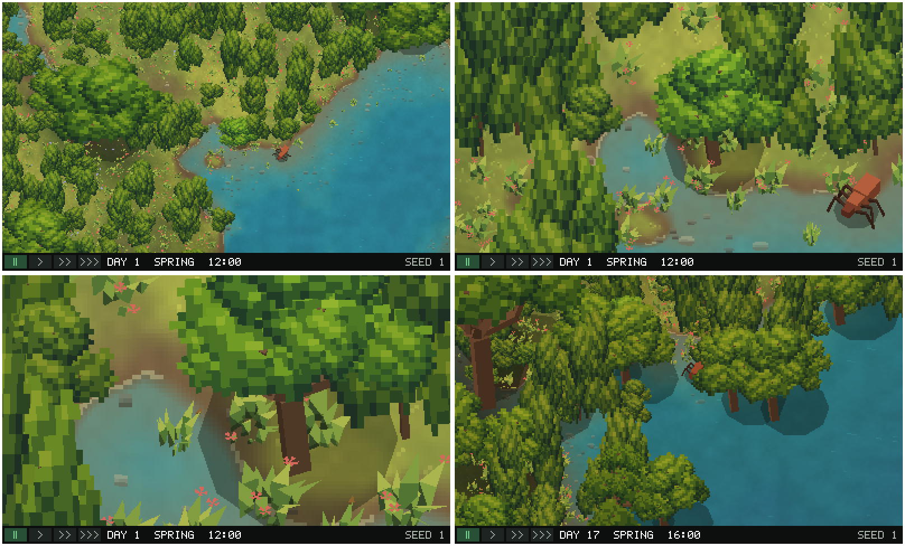
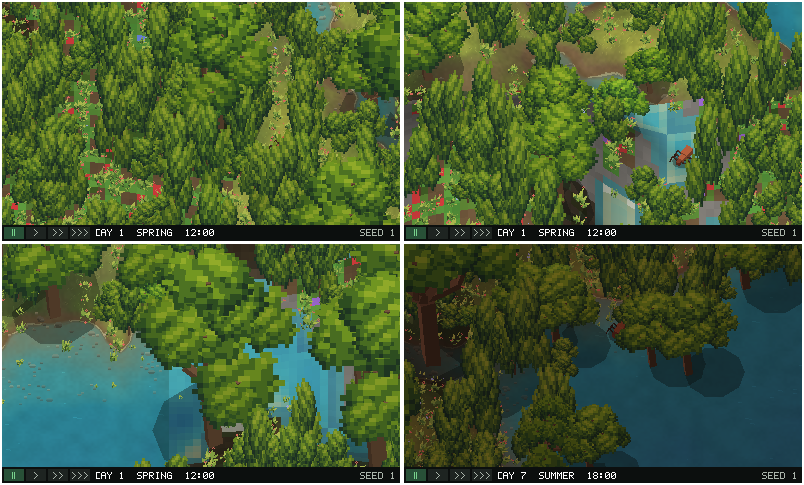
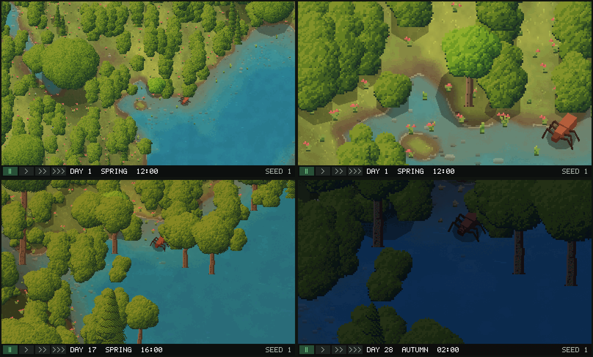
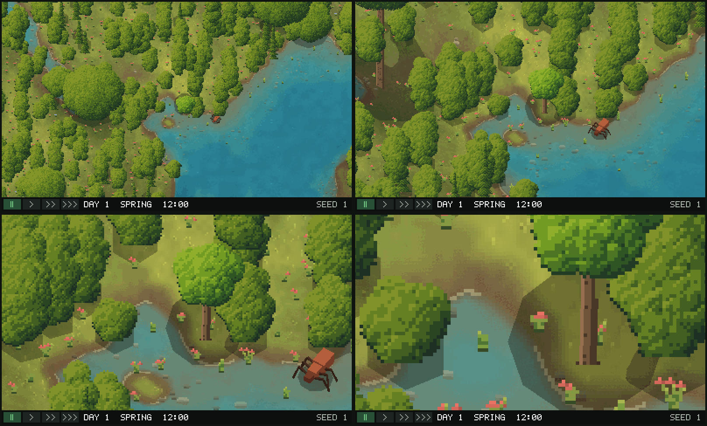

# Shoreline study: what works, what doesn't

**Status:** November 19, 2026. A review of the shoreline art study at commit
`37f0f5f`, to decide what to build next. The direction is right: painted
pixel art for close inspection of plants, creatures and ground. The study
proves the look at one spot; almost none of it survives leaving that spot,
and it costs far too much to draw.

Measured on a desktop PC (NVIDIA GPU, vsync off, 800 × 480 window, art target
400 × 224). Nothing here has run on the Pi.

## Summary

| Area | Verdict |
| --- | --- |
| Painted ground and shallows | Works, inside one fixed 24 × 24-cell patch |
| Broadleaf crowns at 40–64 px per cell | Works |
| Reference composition and palette | Works |
| Foliage cost | Does not work: 223,000 triangles rebuilt and uploaded every frame |
| Pixel size consistency | Does not work: leaf pixels scale with the plant and the zoom |
| Variety | Does not work: two leaf patterns for every plant |
| Ground outside the patch | Does not work: falls back to 4-texel blocks with hard seams |
| Grass, reeds and flowers | Wrong style: smooth triangles, not pixels |
| Shadows, trunks, creature, water | Placeholders |
| Ground staying current | Does not work: painted once at startup |

## What works

- **The painted ground.** `gfx/shoreline_art.cpp` paints soil, turf, wet
  margin, a pale waterline, bed colour seen through shallows, pebbles and
  grass flecks at 32 texels per cell. At 64 px per cell the art target shows
  32 art pixels per cell, so one texel lands on one art pixel. This is the
  strongest part of the study.
- **It is driven by the simulation.** Water depth, plant cover, canopy
  shade and wetness all come from the world, warped by noise so cell edges
  don't show. Tufts and shrubs stand where simulated plants are, with their
  heights, dormancy and flower colour.
- **Broadleaf crowns at the reference zoom.** Layered sprays with five tones
  read as painted foliage, and the depth buffer sorts them correctly.
- **The pixel grid.** Everything goes through the half-resolution target,
  so edges are crisp and panning doesn't crawl.
- **Day tint.** Dusk and night shots hold together.
- **The plumbing.** `--shoreline-study`, `--shot`, `--frames`, `--zoom` and
  `--at` make the study repeatable and measurable.

## What doesn't work: performance

Paused, at the reference frame (zoom 64):

| Part | Triangles | Share |
| --- | --- | --- |
| Shrubs | 171,492 | 77% |
| Grass and reed tufts | 24,636 | 11% |
| Trees (10 in view) | 24,020 | 11% |
| Terrain mesh | 4,096 | 2% |

| Run | Mean frame | Scene triangles |
| --- | --- | --- |
| Study, paused, zoom 128 | 4.6 ms | 120,730 |
| Study, paused, zoom 64 | 9–17 ms | 222,740 |
| Study, playing, zoom 64 | 18–31 ms | 272,965 |
| Study, paused, zoom 40 | 26 ms, peaks to 59 ms | 354,995 |

For scale, `RENDERING.md` records the earlier tilted view drawing 115 trees
in 17,500 triangles.

- **Everything is rebuilt every frame.** `TiltView::build_scene` regenerates
  every vertex on the CPU and uploads about 16 MB with `glBufferData`, even
  when paused and nothing has moved.
- **Shrubs are the bulk.** Each woody shrub is a full painted crown: 11
  box beams and 5 leaf sprays, about 800 triangles. Most of what reads as
  conifers in the screenshots are shrubs.
- **Leaf sprays are expensive by design.** Each spray draws one quad per run
  of same-coloured pixels in a 16 × 12 pattern, about 130 triangles to show
  one small sprite.
- **Cost grows as you zoom out.** The visible area grows with the square of
  the zoom-out and there is no level of detail before the switch to the flat
  view at 32.
- **Frame time breakdown, paused:** terrain bake 1.9 ms, scene build and
  draw submission 5.3 ms (build alone 3.7 ms), then 2.2 ms in the interface
  stage.
- **Playing adds 6–10 ms in the interface stage, not the simulation.** The
  interface code is trivial and the same in both modes, so this is most
  likely the driver waiting for the GPU to finish the scene before the
  target texture can be sampled. Not confirmed.
- **GPU time is under-reported.** `frame_ms` stops before the buffer swap,
  so the real cost is higher than the tables show.
- **The Pi cannot run this.** A desktop GPU already misses 60 fps at zoom
  40. The budget in `PLAN.md` is 60 fps and about 4 layers of overdraw on a
  VideoCore IV.

## What doesn't work: visuals

Top row: zoom 40 and 128. Bottom row: zoom 256, and tick 4,000 at the
reference frame.

- **Pixel size is not consistent.** Leaf patterns are stretched to the size
  of the plant, so a large tree has pixels several times the size of a
  shrub's. Zooming in enlarges them further: at 128 and 256 the crowns are
  big blocks while the grass beside them stays razor sharp.
- **Grass, reeds and flowers are a different style.** They are smooth
  shaded triangles at screen resolution. At 128 and above they read as
  low-poly 3D, next to pixel-art crowns.
- **Two patterns for everything.** One broadleaf and one pine spray, mirrored.
  Conifers and tall shrubs read as the same stamp repeated, most clearly at
  zoom 40.
- **Leaf pixels are skewed.** Sprays sit on tilted planes in 3D, so their
  pixels are neither square nor aligned to the art grid.
- **Trunks, branches and the creature are flat-shaded boxes.**
- **Shadows are dark ten-sided discs.** They stack where they overlap, and
  they are drawn on open water (tick 4,000 shot).
- **Water is a still, opaque painting.** No ripples, no flow, no foam, and
  trees that end up in rising water stand in it with no waterline.

Top row: panned west and south. Bottom row: panned east, and tick 1,620.

- **The ground only exists in one patch.** Outside the 24 × 24 cells the
  shader falls back to the 4-texel terrain bake: blocky cyan water, grey and
  brown squares, with a hard seam where the patch ends.
- **Low plants are drawn twice outside the patch.** The 4-texel bake still
  paints its own plant patches and flower cells (the red, blue and purple
  squares), underneath the standing tufts.
- **The ground goes stale.** The patch is painted once at startup. While the
  study plays, water levels, cover and seasons change and the ground does
  not. `--ticks N` only looks right because it bakes after running ahead.
- **Nothing ties the study to seasons.** Snow, autumn colour on the ground
  and burnt ground are not painted.

## Why caching alone is not enough

Caching the geometry (build each chunk's foliage once, rebuild when its
plants change, sway in the vertex shader) removes the per-frame rebuild and
upload. It still leaves 200,000–350,000 triangles to draw each frame, which
is beyond the Pi, and it fixes none of the visual problems.

The pixel-size problem and the cost problem have the same cause: leaves are
geometry that scales. The fix for both is to paint each plant once into a
sprite at a fixed number of texels per cell, and draw it as one upright quad.

## Proposed direction

**1. Plant sprites, painted on the CPU into an atlas.**

- A painter in the style of `shoreline_art.cpp`: no GL, deterministic, so
  headless screenshots match the window.
- Fixed density: 32 texels per cell, the art-pixel density at zoom 64. Bigger
  plants get more pixels, not bigger ones.
- Shape from the genome and the plant's id: crown form, leaf tone, density,
  height, bare or dormant, flowering. Many variants, cached by a quantised
  key so similar plants share a sprite.
- Trunk, branches, crown, grass tufts, reeds and flowers are all painted the
  same way, which puts them in one style.
- This matches `PLAN.md`: plant sprites generated from the genome, batched
  from one atlas.

**2. Drawing.**

- One upright quad per plant, alpha-tested, depth-tested, sampled nearest.
- Estimated from the triangle counts above: about 200 shrubs, 800 tufts and
  10 trees in the reference frame, so roughly 2,000 triangles in place of
  219,000.
- Sway by shearing the quad's top edge, in the vertex shader.
- Quads are cached per terrain chunk and rebuilt only when that chunk's
  plants change.

**3. Ground everywhere.**

- The shoreline painter generalised from one fixed patch to the 16-cell
  chunks on screen, baked within a per-frame budget like the 4-texel bake,
  and rebaked as water and cover change.
- The 4-texel bake stops painting low plants wherever sprites stand.

**4. After that:** painted shadows, moving water, and the creature as a
painted, rigged sprite.

## Open questions

- **Zoom above 64.** Sprites at 32 texels per cell double in size at 128.
  Either accept that, or paint a second atlas at 64 texels per cell.
- **Pitch.** The camera tilts from 55° to 45° as it zooms in. A sprite is
  painted for one viewing angle; whether the drift is visible needs trying.
- **Bake cost of the detailed ground.** Not measured. The study bakes its
  768 × 768 patch at startup, outside the frame timer.
- **Atlas size on the Pi.** Textures are limited to 2048 × 2048.
- **Where the extra frame time while playing goes.** Worth confirming once
  the triangle count is down.

## Progress

**Plant sprites and cached drawing (steps 1 and 2): done on the
`plant-sprites` branch.** Same PC and settings as the tables above.

| Run | Mean frame before | Mean frame now | Triangles before | Triangles now |
| --- | --- | --- | --- | --- |
| Paused, zoom 64 | 9–17 ms | 2.0 ms | 222,740 | 18,594 |
| Playing, zoom 64 | 18–31 ms | 2.1 ms | 272,965 | about 19,000 |
| Playing at 4×, zoom 64 | not measured | 2.3 ms | not measured | 19,404 |
| Paused, zoom 40 | 26 ms | 1.9 ms | 354,995 | 18,594 |
| Paused, zoom 128 | 4.6 ms | 1.1 ms | 120,730 | 16,546 |

- 4,677 plant sprites in 8 draw calls at the reference frame. About 9,400
  of the triangles are sprites, 5,000 are shadows and 4,100 terrain.
- The first frame takes about 40 ms while the sprites in view are painted.
- Fixed by this step: the per-frame rebuild, mixed pixel sizes, the split
  between pixel-art crowns and triangle grass, the two repeated leaf
  patterns, skewed leaf pixels, and shadows drawn on open water.
- Still open from the lists above: the ground outside the patch, the stale
  ground, shadows as flat polygons, the box creature, and still water.
- New, and not yet tried: what happens when the atlas fills (a forest of
  many large, different trees). The code stands in the nearest painted
  sprite and repaints the atlas every 600 frames, but no scene has
  exercised it. The atlas is 2048 × 2048 RGBA, 16 MB, which is the Pi's
  largest texture.
- At zoom 40 sprites are drawn at five-eighths size, sampled nearest, so
  their texels no longer land one to a pixel.

**Tuning after the first look (same branch).**

- **Depth near top-down, fixed.** Between 32 and 64 px per cell the camera
  is close to straight down, and whole-tree sprites sorted by ground height
  alone: crowns were cut off by the ground and by bushes behind them. Trees
  are now pieces, each sorted by where it hangs.
- **Trees follow the camera's pitch, fixed.** Trunk and crown are separate
  sprites, and conifers are a stack of boughs. Looking down, a crown sits
  over its spot; at 45° it stands on a long trunk.
- **Horizontal banding in leaves, fixed.** Leaf dabs were laid in rows three
  texels high. They are now a scatter of leaves with no rows.
- **Gaps in trunks, fixed.** A rounding error left some rows unpainted.
- Cost is unchanged: 2.1 ms and 18,722 triangles paused at zoom 64 (4,741
  sprites, 8 draw calls).
- **Plants sliding off the ground while playing, fixed.** The lake under
  the study is still filling at tick 120: its surface rises about 0.5 cells
  in 80 ticks, and the ground mesh follows the water. Plants were placed on
  the newest heights while each mesh waited its turn to be rebuilt, two
  chunks every 15 frames across the whole map, so plants near the shore rose
  ahead of the ground. Now anything on the ground stands on the heights its
  mesh was built with, a chunk's plants are rebuilt with its mesh, and
  meshes on screen catch up as they are drawn.
- Still approximate: grass, reeds and bushes keep one painted height at
  every pitch, and a crown is the same picture from above as from the side.

